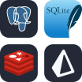

<h1 align="center">Hi 👋, I'm Justin</h1>

<h3 align="center">🛠️ Tech Stack</h3>

<table align="center">
  <tr>
    <th align="left" width="25%">💻&nbsp;Languages</th>
    <th align="left" width="25%">⚙️&nbsp;Runtime</th>
    <th align="left" width="25%">🧩&nbsp;Frameworks</th>
    <th align="left" width="25%">🗄️&nbsp;Databases</th>
  </tr>
  <tr>
    <td align="left" valign="top"></td>
    <td align="left" valign="top"></td>
    <td align="left" valign="top"></td>
    <td align="left" valign="top"></td>
  </tr>
  <tr>
    <th align="left">🏗️&nbsp;Build</th>
    <th align="left">🐳&nbsp;DevOps</th>
    <th align="left">🔀&nbsp;Version&nbsp;Control</th>
    <th align="left">🖥️&nbsp;Editors</th>
  </tr>
  <tr>
    <td align="left" valign="top"></td>
    <td align="left" valign="top"></td>
    <td align="left" valign="top"></td>
    <td align="left" valign="top"></td>
  </tr>
</table>
